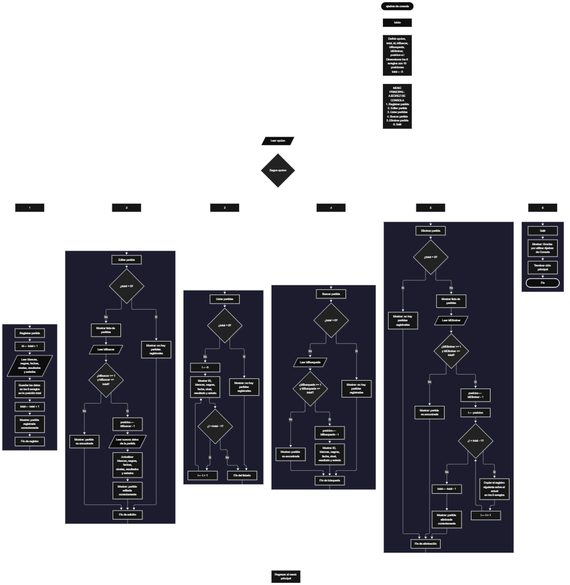

Este proyecto, llamado <b>Ajedrez de Consola</b>, fue desarrollado en <b>Java</b> como un ejercicio práctico para fortalecer la lógica de programación mediante la creación de un sistema de gestión de partidas de ajedrez desde la consola. El programa cuenta con un menú principal de seis opciones que permite <b>registrar, editar, listar, buscar y eliminar partidas</b>, además de finalizar la ejecución del programa. Cada partida almacena datos como los nombres de los jugadores con piezas blancas y negras, la fecha, el nivel de dificultad, el resultado y el estado de la partida, utilizando arreglos con una capacidad máxima de <b>10 partidas durante la ejecución</b>. Durante su desarrollo se aplicaron conceptos fundamentales de programación, como variables, arreglos, estructuras condicionales, ciclos repetitivos y estructuras de selección, además de procesos para buscar, modificar, eliminar y organizar registros. Este proyecto permite poner en práctica los conocimientos adquiridos en Java y sirve como base para desarrollar sistemas de gestión más avanzados utilizando otros lenguajes y tecnologías.

<h2 align="center">⚙️ Funcionamiento del menú principal</h2>

### ➕ Registrar partida

La opción <b>1) registrar partida</b> permite almacenar una nueva partida de ajedrez en el sistema. Para realizar el registro, el programa utiliza la variable <b>id</b>, que obtiene el identificador de la nueva partida mediante la operación <b>total + 1</b>. Después, solicita los nombres de los jugadores con piezas blancas y negras, la fecha de la partida, el nivel de dificultad, el resultado y el estado de la partida. Los datos introducidos se almacenan en sus respectivos arreglos utilizando la posición indicada por la variable <b>total</b>. Finalmente, muestra el mensaje <b>"partida registrada correctamente."</b> y aumenta la variable <b>total</b> en uno. Los arreglos tienen una capacidad máxima de <b>10 partidas</b>, aunque el código actual no incorpora una validación para impedir registros cuando se alcanza ese límite.

### ✏️ Editar partida

La opción <b>2) editar partida</b> permite modificar la información de una partida registrada. Primero, el programa comprueba si existen partidas almacenadas mediante la variable <b>total</b>. Si no hay registros, muestra el mensaje <b>"no hay partidas registradas."</b>. En caso contrario, presenta una lista con el identificador y los datos de cada partida. Después, solicita el identificador de la partida que se desea editar y comprueba que esté dentro del rango permitido mediante la condición <b>idBuscar &gt;= 1 y idBuscar &lt;= total</b>. Si la selección es válida, utiliza la operación <b>posicion = idBuscar - 1</b> para determinar la posición correspondiente en los arreglos. A continuación, solicita los nuevos nombres de los jugadores, la fecha, el nivel de dificultad, el resultado y el estado, actualizando directamente los valores almacenados. Finalmente, presenta el mensaje <b>"partida editada correctamente."</b>. Si el identificador seleccionado no corresponde a una partida registrada, informa que la partida no existe.

### 📋 Listar partidas

La opción <b>3) listar partidas</b> permite visualizar todas las partidas registradas actualmente en el sistema. Antes de mostrar la información, el programa comprueba si la variable <b>total</b> es igual a cero. Si no existen registros, presenta el mensaje <b>"no hay partidas registradas."</b>. Si hay partidas disponibles, utiliza un ciclo <b>for</b> para recorrer los arreglos desde la primera posición hasta el número total de partidas registradas. Durante el recorrido, muestra el identificador, los nombres de los jugadores con piezas blancas y negras, la fecha, el nivel de dificultad, el resultado y el estado de cada partida. El identificador se obtiene mediante la posición del recorrido más uno. Esta función facilita consultar los registros existentes sin necesidad de buscar cada partida individualmente.

### 🔎 Buscar partida

La opción <b>4) buscar partida</b> permite localizar una partida mediante su identificador. Primero, el programa comprueba si existen partidas registradas. Si el sistema está vacío, muestra el mensaje <b>"no hay partidas registradas."</b>. En caso contrario, solicita el identificador de la partida que se desea buscar y verifica que esté dentro del rango permitido mediante la condición <b>idBusqueda &gt;= 1 y idBusqueda &lt;= total</b>. Si el identificador es válido, utiliza la operación <b>posicion = idBusqueda - 1</b> para acceder a la información almacenada en los arreglos correspondientes. A continuación, muestra los datos completos de la partida: <b>jugadores con piezas blancas y negras, fecha, nivel de dificultad, resultado y estado</b>. Si el identificador introducido no corresponde a ninguna partida registrada, presenta el mensaje indicando que la partida no existe.

### 🗑️ Eliminar partida

La opción <b>5) eliminar partida</b> permite eliminar una partida registrada mediante su identificador dentro de la lista. Antes de comenzar, el programa comprueba que existan partidas almacenadas. Si no hay registros, muestra el mensaje <b>"no hay partidas registradas."</b>. Si hay partidas disponibles, presenta una lista con los identificadores y los datos de cada partida. Después, solicita el identificador de la partida que se desea eliminar y verifica que la selección esté dentro del rango válido. Si la partida existe, utiliza la operación <b>posicion = idEliminar - 1</b> para determinar su ubicación en los arreglos. Para mantener los registros organizados, utiliza un ciclo <b>for</b> que desplaza una posición hacia atrás los datos de las partidas posteriores en los seis arreglos: <b>blancas, negras, fechas, niveles, resultados y estados</b>. Posteriormente, disminuye la variable <b>total</b> en uno y muestra el mensaje <b>"partida eliminada correctamente."</b>. Si el identificador seleccionado no corresponde a una partida registrada, informa que la partida no existe.

### 🚪 Salir del menú principal

La opción <b>6) salir</b> está destinada a finalizar la ejecución del programa y muestra el mensaje <b>"Gracias por utilizar Ajedrez de Consola."</b>. El menú principal se encuentra dentro de una estructura repetitiva <b>do-while</b>, que mantiene el programa en funcionamiento mientras se realizan las operaciones disponibles. Cuando el usuario selecciona la opción <b>6</b>, el mensaje de despedida se muestra y la condición <b>opcion != 6</b> deja de cumplirse, finalizando el ciclo y terminando la ejecución del programa.

<h2 align="center">🧠 Temas aplicados en el proyecto</h2>

### 📦 Variables

En este proyecto se utilizan variables para almacenar la opción seleccionada en el menú, controlar la cantidad de partidas registradas, generar identificadores, recorrer los arreglos y seleccionar las partidas que se desean editar, buscar o eliminar. Cada variable cumple una función específica dentro de las operaciones de gestión de partidas.

🔢 **Opcion:** Almacena la opción seleccionada por el usuario en el menú principal.

📊 **Total:** Almacena la cantidad actual de partidas registradas.

🆔 **Id:** Almacena el identificador generado para una nueva partida.

🔄 **I:** Funciona como contador en los ciclos `for` y permite recorrer los arreglos.

🔎 **IdBuscar:** Almacena el identificador introducido por el usuario para editar una partida.

🔍 **IdBusqueda:** Almacena el identificador introducido por el usuario para buscar una partida.

🗑️ **IdEliminar:** Almacena el identificador introducido por el usuario para eliminar una partida.

📍 **Posicion:** Permite determinar la posición correspondiente de una partida dentro de los arreglos mediante la operación `id - 1`.

### 🗃️ Arreglos

En este proyecto se utilizan seis arreglos relacionados con la información de cada partida de ajedrez. Cada arreglo tiene una capacidad de <b>10 posiciones</b> y utiliza el mismo índice para representar los datos correspondientes a una misma partida. Por ejemplo, la información de una partida almacenada en la posición <b>0</b> se encuentra distribuida entre <b>blancas[0], negras[0], fechas[0], niveles[0], resultados[0] y estados[0]</b>. Esta organización permite recorrer, buscar, modificar, mostrar y eliminar las partidas de manera ordenada.

♔ **Blancas[10]:** Almacena los nombres de los jugadores que utilizan las piezas blancas.

♚ **Negras[10]:** Almacena los nombres de los jugadores que utilizan las piezas negras.

📅 **Fechas[10]:** Almacena las fechas en las que se realizan las partidas.

🎯 **Niveles[10]:** Almacena los niveles de dificultad de las partidas.

🏆 **Resultados[10]:** Almacena los resultados obtenidos en las partidas.

📌 **Estados[10]:** Almacena los estados actuales de las partidas.

### 🔀 Estructuras condicionales

En este proyecto se utilizan las estructuras <b>if</b> y <b>else</b> para comprobar si existen partidas registradas antes de realizar determinadas operaciones y verificar que el identificador seleccionado esté dentro del rango permitido para editar, buscar o eliminar una partida. Estas condiciones permiten que el programa responda de manera diferente según la cantidad de registros almacenados y la selección realizada por el usuario.

### 🔄 Estructuras repetitivas

En este proyecto se utilizan los ciclos <b>for</b> y <b>do-while</b>. Los ciclos <b>for</b> permiten recorrer los arreglos para mostrar las partidas registradas y desplazar los datos de las partidas posteriores durante el proceso de eliminación. Por otro lado, el ciclo <b>do-while</b> mantiene activo el menú principal para que el usuario pueda ejecutar diferentes operaciones antes de salir del programa.

### 🎯 Estructura switch

El programa utiliza la estructura <b>switch</b> para evaluar el valor almacenado en la variable <b>opcion</b> y ejecutar el bloque de instrucciones correspondiente. Cada caso representa una operación específica del sistema: <b>registrar, editar, listar, buscar, eliminar o salir</b>. También se utiliza el bloque <b>default</b> para mostrar el mensaje <b>"Opción inválida."</b> cuando el usuario introduce un número que no coincide con ninguna de las opciones definidas en el menú.

### 🔢 Dimensionamiento de arreglos

El programa utiliza la instrucción de creación de arreglos de Java para establecer la capacidad de los espacios que almacenan la información de las partidas. Se definieron seis arreglos de tipo <b>String</b> con <b>10 posiciones</b> cada uno, lo que permite almacenar hasta 10 partidas durante la ejecución. La cantidad de posiciones ocupadas se controla mediante la variable <b>total</b>, por lo que las operaciones recorren únicamente los registros comprendidos entre la primera posición y el total actual de partidas.

### 🔄 Reorganización de registros

Cuando se selecciona una partida para eliminarla, el programa utiliza un ciclo <b>for</b> que comienza en la posición seleccionada y llega hasta <b>total - 1</b>. En cada repetición, los datos de la posición siguiente se copian sobre la posición actual en los seis arreglos: <b>blancas, negras, fechas, niveles, resultados y estados</b>. Después, la variable <b>total</b> disminuye en uno. De esta manera, las partidas posteriores ocupan las posiciones disponibles sin dejar espacios vacíos entre los registros activos.

<h2 align="center">¿Cómo se implementaron las operaciones crud en el proyecto?</h2>

Las operaciones <b>crud</b> se implementaron mediante las opciones del menú principal, permitiendo administrar las partidas registradas. La operación <b>crear</b> corresponde a <b>registrar partida</b>, donde se introducen los datos de una nueva partida; <b>leer</b> se realiza mediante las opciones <b>listar partidas y buscar partida</b>, que permiten consultar los registros almacenados; <b>actualizar</b> corresponde a <b>editar partida</b>, donde se modifican los datos de una partida registrada; y <b>eliminar</b> se realiza mediante la opción <b>eliminar partida</b>. Estas operaciones utilizan variables, arreglos, condicionales y ciclos para gestionar la información almacenada temporalmente durante la ejecución del programa.

<h2 align="center">Diagrama de flujo del proyecto</h2>

<h2 align="center">🛡️ Validaciones del programa</h2>

### 📭 No existen partidas registradas

Esta validación se utiliza en las opciones de <b>editar, listar, buscar y eliminar partidas</b>. El programa comprueba si la variable <b>total</b> es igual a <b>0</b> y, si no existen partidas registradas, muestra el mensaje <b>"No hay partidas registradas."</b>. Esta comprobación evita continuar con las operaciones que necesitan información almacenada cuando el sistema está vacío.

### 🔢 Selección de partidas

El programa utiliza los identificadores para localizar la posición de la partida que se desea editar, buscar o eliminar. Antes de realizar estas operaciones, comprueba que el identificador introducido sea mayor o igual a <b>1</b> y menor o igual al valor de <b>total</b>. Si la selección está dentro del rango permitido, calcula la posición correspondiente mediante la operación <b>posicion = id - 1</b>. Si el identificador está fuera de ese rango, muestra el mensaje indicando que la partida no existe. Esta validación evita acceder a posiciones que no corresponden a partidas registradas.

### ⚠️ Capacidad máxima de los arreglos

Los seis arreglos del programa tienen una capacidad máxima de <b>10 posiciones</b>. Sin embargo, el código actual no incorpora una condición que compruebe si existe espacio disponible antes de registrar una nueva partida. Por este motivo, si el usuario intenta registrar más de 10 partidas durante la ejecución, el programa puede generar una excepción <b>ArrayIndexOutOfBoundsException</b> al intentar acceder a una posición que no existe dentro de los arreglos.

### ❌ Partida no encontrada

Esta validación se utiliza cuando el usuario intenta editar, buscar o eliminar una partida mediante su identificador. El programa comprueba que el número introducido esté dentro del rango comprendido entre <b>1</b> y <b>total</b>. Si el identificador no corresponde a una partida registrada, presenta el mensaje indicando que la partida no existe. Esta comprobación evita realizar operaciones sobre identificadores que no se encuentran disponibles en el sistema.

### ⚠️ Opción inválida

La estructura <b>switch</b> incluye el bloque <b>default</b>, que muestra el mensaje <b>"Opción inválida."</b> cuando el usuario introduce un número que no corresponde a ninguna de las seis opciones definidas en el menú principal. De esta manera, el programa informa cuando se selecciona una opción que no está disponible.

<h2 align="center">🎯 Objetivo del proyecto</h2>

El objetivo principal de este proyecto es fortalecer la <b>lógica de programación</b> mediante el desarrollo de un sistema de gestión de partidas de ajedrez en <b>Java</b>. A través de su construcción se busca aplicar los conocimientos adquiridos sobre variables, arreglos, estructuras condicionales, ciclos repetitivos y estructuras de selección, integrándolos para resolver un problema de manera organizada. Además, el proyecto permite comprender cómo registrar, consultar, modificar y eliminar información en una aplicación de consola, estableciendo una base para desarrollar sistemas de gestión más completos con otros lenguajes y tecnologías.

